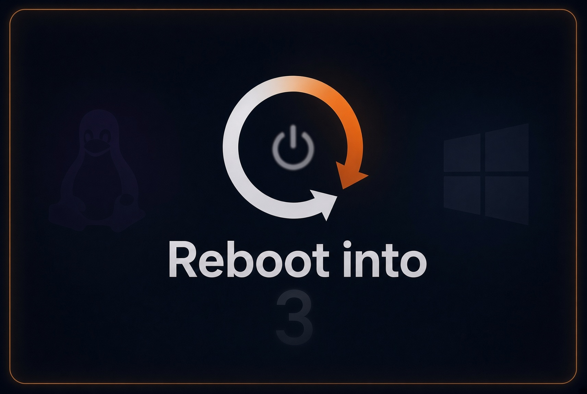
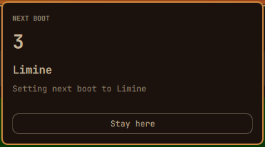

# Reboot into

An [Omarchy](https://omarchy.org/) bar plugin. The restart glyph sits in the
top bar. Open it and the menu lists the operating systems in the firmware boot
menu, plus a plugged-in removable USB drive that can boot. The drive needs
the fallback loader. Pick one and the panel counts down, types out what it
is about to do, then reboots into that system for the next boot only.

The popup uses the shell theme: popup surface, bar foreground, bar font, and
the same hover and selected fills as the built-in panels.





## Install

Omarchy with the Quickshell shell, plus `efibootmgr` and `jq`. Both ship with
Omarchy.

```bash
omarchy plugin add https://github.com/07dcolem/omarchy-target-boot.git --enable
```

The icon lands on the right of the bar. Move it with:

```bash
omarchy bar move io.github.07dcolem.target-boot --section right
```

Remove it with:

```bash
omarchy plugin remove io.github.07dcolem.target-boot
```

Setting the next boot needs a root-owned helper. The menu can list the
firmware without it. A partitionless USB drive that does not already have
an entry also needs the USB helper installed beside it. Install both once,
in a terminal. The policy asks for the password every time. It does not
remember it.

```bash
plugin=~/.config/omarchy/plugins/io.github.07dcolem.target-boot
sudo install -d -o root -g root -m 0755 /usr/local/libexec/io.github.07dcolem.target-boot
sudo install -o root -g root -m 0755 "$plugin/bin/supervise" /usr/local/libexec/io.github.07dcolem.target-boot/supervise
sudo install -o root -g root -m 0755 "$plugin/bin/arm-usb" /usr/local/libexec/io.github.07dcolem.target-boot/arm-usb
sudo install -o root -g root -m 0644 "$plugin/polkit/io.github.07dcolem.target-boot.policy" /usr/share/polkit-1/actions/io.github.07dcolem.target-boot.policy
```

Those files stay after `omarchy plugin remove`. Remove them with:

```bash
sudo rm -f /usr/local/libexec/io.github.07dcolem.target-boot/supervise /usr/local/libexec/io.github.07dcolem.target-boot/arm-usb /usr/share/polkit-1/actions/io.github.07dcolem.target-boot.policy
sudo rmdir /usr/local/libexec/io.github.07dcolem.target-boot
```

## Using it

| Where | Action |
|---|---|
| Bar icon | left click opens the menu, right click reads the firmware and USB drives again |
| Operating system row | starts the countdown for that system |
| USB row | starts the countdown for that drive. There is no rename or hide |
| ⋮ on a firmware row | Rename or Hide |
| Hidden | lists the systems you hid, and shows one again |
| Stay here | cancels the countdown. Esc always does this too |
| Go now | skips the rest of the countdown. Shift+Enter does this too |
| Clear next boot | drops a next boot that is already armed |

The ⋮ menu sits at the end of each firmware row. **Rename** edits the name shown in this plugin. **Hide** takes that system off the list. **Hidden** at the bottom of the menu lists every hidden system, including one the firmware no longer has, and **Unhide** puts it back. Rename and hide are saved on the widget. The firmware menu stays as it is. An inactive system shows in the main list again when **Show inactive entries** is on. A USB row has no ⋮ menu. A firmware row has no ⋮ menu when it points at the same partitioned stick. A firmware entry for a stick with no partition table keeps the menu.

A USB row appears only when the stick is removable USB and actually has `\EFI\BOOT\BOOTX64.EFI`, or the 32-bit or ARM fallback of that same path. The name is the volume label. The line under it is the size and the loader file. Right-click and `r` look again. Nothing is written until the countdown finishes.

The first time the menu opens, and the first time `target-boot list` is run in a terminal, it asks whether the system you are in should be shown as **Omarchy**. Either answer is remembered on the widget. Esc closes the menu without answering, so the question comes back next time. A list captured by another program, including the panel's own refresh, is not a terminal and is never asked. Windows keeps its own glyph. An Omarchy name uses the square Omarchy mark, in the menu color, at the same size.

Opening the menu puts a large circular restart arrow in the center and spins it. The arrow then settles faint behind the operating systems as they wipe in. A hovered or highlighted operating system gets one slanted shine. **Stay here** and **Go now** grow corner ticks and a star instead.

Keyboard, while the menu is open:

| Key | Action |
|---|---|
| `j` `k` ↑ ↓ | move. During the countdown, down and `j` highlight Go now, up and `k` highlight Stay here |
| `h` `l` ← → | leave the ⋮ button, or move onto it. During the countdown, left highlights Stay here and right highlights Go now |
| `Enter` `Space` | start the countdown, or run the highlighted Stay here / Go now button |
| `Shift+Enter` | during the countdown, go now |
| `.` | open Rename and Hide for the highlighted firmware system. A USB row has no menu |
| `Esc` | close that menu, leave Hidden, cancel the countdown, or close the menu |
| `r` | read the firmware and USB drives again |
| `Tab` | move to the next bar panel |

In the ⋮ menu, `j` and `k` move between Rename and Hide, and Enter runs the highlighted one. In Hidden, Enter shows the highlighted system again. A renamed name is what the countdown and the bar tooltip use. Clearing the field puts the firmware name back.

The current system is marked **This boot**. A system already chosen for the
following boot is marked **Next boot**.

### The countdown

Choosing a system does not reboot on the click. The menu crossfades into a
hold of about six seconds:

1. **4** — “Next boot will be …, just this once.” types out under the name.
2. **3** — “Setting next boot to …”
3. **2** — “The saved boot order stays as it is.”
4. **1** — “Rebooting into …”

The numeral fades and settles on each step. **Stay here** and **Go now** sit
side by side, each half the row. The highlight starts on Stay here. Arrow
keys move it from one button to the other, and Enter or Space runs the
highlighted one. Esc always returns to the list. At that point the firmware
has not been touched.

When the hold ends, the restart glyph pulses, next boot is set, and Omarchy
runs its own reboot (the “Rebooting” indicator, then windows close).

**Go now**, or Shift+Enter, runs the remaining numerals down in a blink, then
a short text cloud, “˚ ✦ poof ✦ ˚”, blooms and fades where the numeral was.
The reboot starts as that cloud disappears. A held key does not repeat that
skip, or the cancel, so each press counts once. From the moment Go now is
pressed, Stay here no longer cancels, and closing the menu does not either.
The firmware is still untouched until the cloud finishes and next boot is written.
On a machine without passwordless sudo, the polkit prompt appears after the
cloud.

Dismissing the menu during the hold cancels it, unless Go now was already
pressed. Once next boot has been written, the reboot continues.

## What gets written

Picking a firmware system writes the one-shot **BootNext** variable
(`efibootmgr --bootnext`). The firmware consumes it on the next boot and then
drops it, so the boot after that follows the saved order again.

Picking a USB drive does that too. When the stick has a partition, and no
firmware entry already points at that partition and the fallback loader, the
helper creates one temporary entry with `efibootmgr --create-only`. That
flag adds the entry without putting it in the saved boot order. The same
invocation sets BootNext to the new id. An entry that already points at
that partition is selected instead, and no second entry is created.

A stick with no partition table, such as a copied installer image, has no
partition for that command to name. If this plugin already has one entry
whose path names that stick, the next boot only selects that entry. That is
one password prompt. Otherwise one root-owned helper writes the temporary
entry and selects it in the same prompt. The load option names the USB
device by its vendor, product, interface, and serial, and the fallback
loader. The helper checks that shape again before it writes. Those bytes are
the helper's standard input. They are not a path argument, and they are not
a file in the plugin directory. The saved boot order is not an argument of
either command. Some firmware adds the USB
device to the saved order on its own while that boot happens.

The label in firmware is always “Reboot into USB”. The operating-system list
leaves that entry out, including after firmware adds it to the saved order.
The USB section, the countdown, and the bar keep the volume label.

A previous “Reboot into USB” entry is removed only when it is not in the
saved boot order. When a new partitionless entry is written, that removal
is part of the same prompt. An entry you have put in the boot order
yourself is left alone.

The saved boot order, the active flag on each entry, and the firmware
timeout stay as they are. After every write, the helper reads the menu back.
The reboot starts only when next boot matches what you picked and the boot
order is unchanged. If the order changed, it stops and does not reboot.

Clearing an armed next boot is `efibootmgr --delete-bootnext`, which removes
that same one-shot variable. It does not delete the temporary USB entry.

Rename and hide are saved on the widget entry in `shell.json`.

Writing next boot needs root. The plugin drops the caller’s environment and
runs the installed supervisor. That supervisor is the program `pkexec` runs.
It then runs only the system copy of `efibootmgr`, or the root-owned USB
helper for a partitionless drive that has no entry yet. The plugin does not
hand `pkexec` a shell string or a file from its own directory. The supervisor
kills that firmware program if the menu is closed or the wait runs out,
including after the password prompt has started it as root. Passwordless
`sudo` is used when the machine already allows that program without a
password. Otherwise `pkexec` asks through Omarchy’s polkit prompt, and that
prompt appears at the end of the countdown. The reboot itself runs as you,
through `omarchy system reboot`, because the logged-in session is already
allowed to reboot.

## Settings

Set these on the widget entry in `~/.config/omarchy/shell.json`, or in
Setup → Plugins.

| Key | Default | What it does |
|---|---|---|
| `showInactive` | `false` | Also list firmware entries marked inactive |
| `names` | none | Boot id to the name shown in the menu. Written by Rename |
| `hidden` | none | Boot ids left out of the main list. Written by Hide |

`names` and `hidden` are edited from the menu. A boot id is four hex digits, the same id `list` prints. A name is at most 80 characters, and at most 64 names and 64 hidden ids are kept. Example:

```json
{
  "id": "io.github.07dcolem.target-boot",
  "names": { "0001": "Windows" },
  "hidden": ["0007"]
}
```

## Scripting

The panel talks to `bin/target-boot`. From a shell:

```bash
~/.config/omarchy/plugins/io.github.07dcolem.target-boot/bin/target-boot list
~/.config/omarchy/plugins/io.github.07dcolem.target-boot/bin/target-boot reboot-into 0001
~/.config/omarchy/plugins/io.github.07dcolem.target-boot/bin/target-boot bootnext 0001
~/.config/omarchy/plugins/io.github.07dcolem.target-boot/bin/target-boot clear-next
~/.config/omarchy/plugins/io.github.07dcolem.target-boot/bin/target-boot reboot-into-usb KEY
```

`list` is JSON. Plugged-in drives are under `usb`, and each `key` is what
`reboot-into-usb` and `bootnext-usb` accept. The panel sends that key only.
The helper looks the stick up again before it writes, and it refuses the
write unless the disk is still removable USB with the same serial.

`reboot-into` sets next boot and reboots. `bootnext` sets next
boot and returns, which is the way to arm a system without leaving this one.
`clear-next` removes it. `--dry-run` prints the exact argv and does not touch
the firmware. A saved listing (`--fixture`, `--usb-fixture`) is refused when
the command would actually write.

From the running shell:

```bash
omarchy-shell io.github.07dcolem.target-boot toggle
omarchy-shell io.github.07dcolem.target-boot list
omarchy-shell io.github.07dcolem.target-boot rebootInto 0001
```

`rebootInto` opens the menu and starts the same countdown. It does not skip
the hold. Go now and Shift+Enter do that from the panel.

## How it works

`Panel.qml` is the bar widget and the popup. `Model.js` is the countdown copy,
the row text, the name map, the hidden list, the USB rows, and the JSON parsing, with no
processes in it. `bin/target-boot` decides what to write. The installed
supervisor is the program that runs `efibootmgr` as root.
It is also what looks at USB drives. A volume that is already mounted is read
in place and left mounted. A volume this scan mounted itself, through
`udisksctl` as you, is unmounted when the look finishes. The loader path
written to firmware is only `\EFI\BOOT\BOOTX64.EFI`, `\EFI\BOOT\BOOTIA32.EFI`,
or `\EFI\BOOT\BOOTAA64.EFI`.

Device paths and labels are firmware data. Every line of text in the panel is
plain text, and labels are passed to `jq` as arguments, so a name cannot
become a command or markup.

A saved `efibootmgr` listing can be passed with `--fixture` for tests. A
fixture is refused when the command would actually write.

```bash
node test/model.test.js
bash test/script.test.sh
omarchy plugin validate .
```

## Changelog

### 1.4.2

- Setting next boot runs a root-owned helper. If the menu is closed or the wait runs out, that helper kills the firmware program, including after the password prompt has started it as root.
- The menu still lists firmware without the helper. Install the helper once. The partitionless USB helper installs beside it.

### 1.4.1

- The boot menu stops waiting after 20 seconds. A reboot or a clear of next boot stops waiting after 3 minutes, which leaves time to answer the password prompt, and the menu is usable again after that.
- Closing the menu stops the helper and the programs it started, including a password prompt that is still open.
- A helper that fails to start no longer leaves the menu busy.
- A finished firmware read is applied, so the menu does not stay on “Reading firmware…”.

### 1.4.0

- A plugged-in removable USB drive with `\EFI\BOOT\BOOTX64.EFI`, or the 32-bit or ARM fallback, is listed in its own section. Choosing it counts down, then sets next boot to that drive.
- A partitioned stick gets a temporary `efibootmgr --create-only` entry, so the saved boot order is not changed. A stick with no partition table is armed in one password prompt by a root-owned helper, or the existing entry for that stick is selected. The menu shows the volume label.
- USB rows have no rename or hide menu. A firmware row has no menu when it points at the same partitioned stick.
- The temporary “Reboot into USB” entry stays out of the operating-system list.

### 1.3.2

- The menu loads on a shell that does not already provide a scrollbar type. The list scrollbar comes from Qt Quick Controls.

### 1.3.1

- Rename uses a one-line editor that handles typing itself. It is created only while the menu is open and that row is being renamed. The name stays within 80 characters.

### 1.3.0

- The menu opens on a large spinning circular restart arrow. It then sits faint behind the operating systems.
- The first time you open the menu, or run `target-boot list` in a terminal, you can name the current boot Omarchy. That row uses the square Omarchy mark. Windows keeps its own glyph.
- Hovering an operating system runs a slanted shine. Stay here and Go now use corner ticks and a star.

### 1.2.1

- Rename opens one plain-text field for the row being edited, and only while that field is open.

### 1.2.0

- The countdown is four beats, about six seconds. The new first line is “Next boot will be …, just this once.”
- **Stay here** and **Go now** share one row. Arrow keys move the highlight between them, and Enter or Space runs the highlighted button. The highlight starts on Stay here. Go now ticks the remaining numerals down, plays a short “poof” cloud, and starts the reboot. Shift+Enter does the same from either button. Esc still cancels, until Go now has been pressed.

### 1.1.0

- Each operating system row has a ⋮ menu with Rename and Hide.
- Rename stores a display name on the widget as `names` in `shell.json`. The firmware name is unchanged, and clearing the field restores it. The list, the countdown, and the bar tooltip use the display name.
- Hide stores boot ids as `hidden` on that same entry. Hidden lists them, including an id the firmware no longer has, and Unhide puts one back in the main list.

### 1.0.1

- Reboot still runs when passwordless `sudo` is unavailable. Elevation is `pkexec /usr/bin/efibootmgr`, without a leading `--`.

## License

MIT
