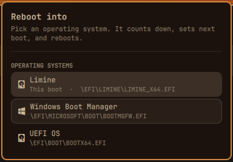
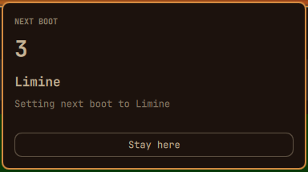

# Reboot into

An [Omarchy](https://omarchy.org/) bar plugin. The restart glyph sits in the
top bar. Open it and the menu lists the operating systems in the firmware boot
menu. Pick one and the panel counts down, types out what it is about to do,
then reboots into that system for the next boot only.

The popup uses the shell theme: popup surface, bar foreground, bar font, and
the same hover and selected fills as the built-in panels.





## Install

Omarchy with the Quickshell shell, plus `efibootmgr` and `jq`. Both ship with
Omarchy.

```bash
omarchy plugin add https://github.com/07dcolem/omarchy-target-boot.git --enable
```

The icon lands on the right of the bar. Move it with:

```bash
omarchy bar move io.github.07dcolem.target-boot --section right
```

Remove it with:

```bash
omarchy plugin remove io.github.07dcolem.target-boot
```

## Using it

| Where | Action |
|---|---|
| Bar icon | left click opens the menu, right click reads the firmware again |
| Operating system row | starts the countdown for that system |
| ⋮ on a row | Rename or Hide |
| Hidden | lists the systems you hid, and shows one again |
| Stay here | cancels the countdown. Esc always does this too |
| Go now | skips the rest of the countdown. Shift+Enter does this too |
| Clear next boot | drops a next boot that is already armed |

The ⋮ menu sits at the end of each row. **Rename** edits the name shown in this plugin. **Hide** takes that system off the list. **Hidden** at the bottom of the menu lists every hidden system, including one the firmware no longer has, and **Unhide** puts it back. Rename and hide are saved on the widget. The firmware menu stays as it is. An inactive system shows in the main list again when **Show inactive entries** is on.

Keyboard, while the menu is open:

| Key | Action |
|---|---|
| `j` `k` ↑ ↓ | move. During the countdown, down and `j` highlight Go now, up and `k` highlight Stay here |
| `h` `l` ← → | leave the ⋮ button, or move onto it. During the countdown, left highlights Stay here and right highlights Go now |
| `Enter` `Space` | start the countdown, or run the highlighted Stay here / Go now button |
| `Shift+Enter` | during the countdown, go now |
| `.` | open Rename and Hide for the highlighted system |
| `Esc` | close that menu, leave Hidden, cancel the countdown, or close the menu |
| `r` | read the firmware again |
| `Tab` | move to the next bar panel |

In the ⋮ menu, `j` and `k` move between Rename and Hide, and Enter runs the highlighted one. In Hidden, Enter shows the highlighted system again. A renamed name is what the countdown and the bar tooltip use. Clearing the field puts the firmware name back.

The current system is marked **This boot**. A system already chosen for the
following boot is marked **Next boot**.

### The countdown

Choosing a system does not reboot on the click. The menu crossfades into a
hold of about six seconds:

1. **4** — “Next boot will be …, just this once.” types out under the name.
2. **3** — “Setting next boot to …”
3. **2** — “The saved boot order stays as it is.”
4. **1** — “Rebooting into …”

The numeral fades and settles on each step. **Stay here** and **Go now** sit
side by side, each half the row. The highlight starts on Stay here. Arrow
keys move it from one button to the other, and Enter or Space runs the
highlighted one. Esc always returns to the list. At that point the firmware
has not been touched.

When the hold ends, the restart glyph pulses, next boot is set, and Omarchy
runs its own reboot (the “Rebooting” indicator, then windows close).

**Go now**, or Shift+Enter, runs the remaining numerals down in a blink, then
a short text cloud, “˚ ✦ poof ✦ ˚”, blooms and fades where the numeral was.
The reboot starts as that cloud disappears. A held key does not repeat that
skip, or the cancel, so each press counts once. From the moment Go now is
pressed, Stay here no longer cancels, and closing the menu does not either.
The firmware is still untouched until the cloud finishes and next boot is written.
On a machine without passwordless sudo, the polkit prompt appears after the
cloud.

Dismissing the menu during the hold cancels it, unless Go now was already
pressed. Once next boot has been written, the reboot continues.

## What gets written

The only firmware write is the one-shot **BootNext** variable
(`efibootmgr --bootnext`). The firmware consumes it on the next boot and then
drops it, so the boot after that follows the saved order again.

Boot order, which entries exist, the active flag on each entry, and the
firmware timeout all stay as they are. After the write, the helper reads the
menu back and compares the boot order with what it was. The reboot starts only
when next boot matches the system you picked and the boot order is unchanged.

Clearing an armed next boot is `efibootmgr --delete-bootnext`, which removes
that same one-shot variable.

Rename and hide are saved on the widget entry in `shell.json`.

Writing next boot needs root. The helper drops the caller’s environment and
runs only the system copy of `efibootmgr`. Passwordless `sudo` is used when
the machine already allows that program without a password. Otherwise
`pkexec` asks through Omarchy’s polkit prompt, and that prompt appears at
the end of the countdown. The reboot itself runs as you, through
`omarchy system reboot`, because the logged-in session is already allowed
to reboot.

## Settings

Set these on the widget entry in `~/.config/omarchy/shell.json`, or in
Setup → Plugins.

| Key | Default | What it does |
|---|---|---|
| `showInactive` | `false` | Also list firmware entries marked inactive |
| `names` | none | Boot id to the name shown in the menu. Written by Rename |
| `hidden` | none | Boot ids left out of the main list. Written by Hide |

`names` and `hidden` are edited from the menu. A boot id is four hex digits, the same id `list` prints. A name is at most 80 characters, and at most 64 names and 64 hidden ids are kept. Example:

```json
{
  "id": "io.github.07dcolem.target-boot",
  "names": { "0001": "Windows" },
  "hidden": ["0007"]
}
```

## Scripting

The panel talks to `bin/target-boot`. From a shell:

```bash
~/.config/omarchy/plugins/io.github.07dcolem.target-boot/bin/target-boot list
~/.config/omarchy/plugins/io.github.07dcolem.target-boot/bin/target-boot reboot-into 0001
~/.config/omarchy/plugins/io.github.07dcolem.target-boot/bin/target-boot bootnext 0001
~/.config/omarchy/plugins/io.github.07dcolem.target-boot/bin/target-boot clear-next
```

`list` is JSON. `reboot-into` sets next boot and reboots. `bootnext` sets next
boot and returns, which is the way to arm a system without leaving this one.
`clear-next` removes it. `--dry-run` prints the exact argv and does not touch
the firmware.

From the running shell:

```bash
omarchy-shell io.github.07dcolem.target-boot toggle
omarchy-shell io.github.07dcolem.target-boot list
omarchy-shell io.github.07dcolem.target-boot rebootInto 0001
```

`rebootInto` opens the menu and starts the same countdown. It does not skip
the hold. Go now and Shift+Enter do that from the panel.

## How it works

`Panel.qml` is the bar widget and the popup. `Model.js` is the countdown copy,
the row text, the name map, the hidden list, and the JSON parsing, with no
processes in it. `bin/target-boot` is the only thing that runs `efibootmgr`.

Device paths and labels are firmware data. Every line of text in the panel is
plain text, and labels are passed to `jq` as arguments, so a name cannot
become a command or markup.

A saved `efibootmgr` listing can be passed with `--fixture` for tests. A
fixture is refused when the command would actually write.

```bash
node test/model.test.js
bash test/script.test.sh
omarchy plugin validate .
```

## Changelog

### 1.2.0

- The countdown is four beats, about six seconds. The new first line is “Next boot will be …, just this once.”
- **Stay here** and **Go now** share one row. Arrow keys move the highlight between them, and Enter or Space runs the highlighted button. The highlight starts on Stay here. Go now ticks the remaining numerals down, plays a short “poof” cloud, and starts the reboot. Shift+Enter does the same from either button. Esc still cancels, until Go now has been pressed.

### 1.1.0

- Each operating system row has a ⋮ menu with Rename and Hide.
- Rename stores a display name on the widget as `names` in `shell.json`. The firmware name is unchanged, and clearing the field restores it. The list, the countdown, and the bar tooltip use the display name.
- Hide stores boot ids as `hidden` on that same entry. Hidden lists them, including an id the firmware no longer has, and Unhide puts one back in the main list.

### 1.0.1

- Reboot still runs when passwordless `sudo` is unavailable. Elevation is `pkexec /usr/bin/efibootmgr`, without a leading `--`.

## License

MIT
